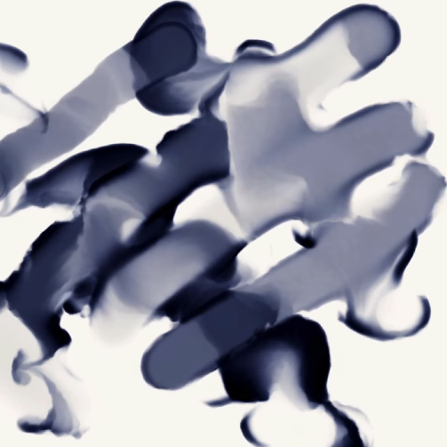
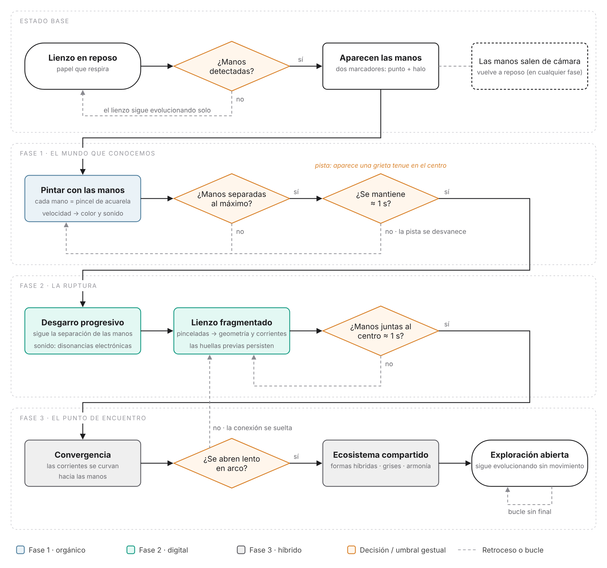
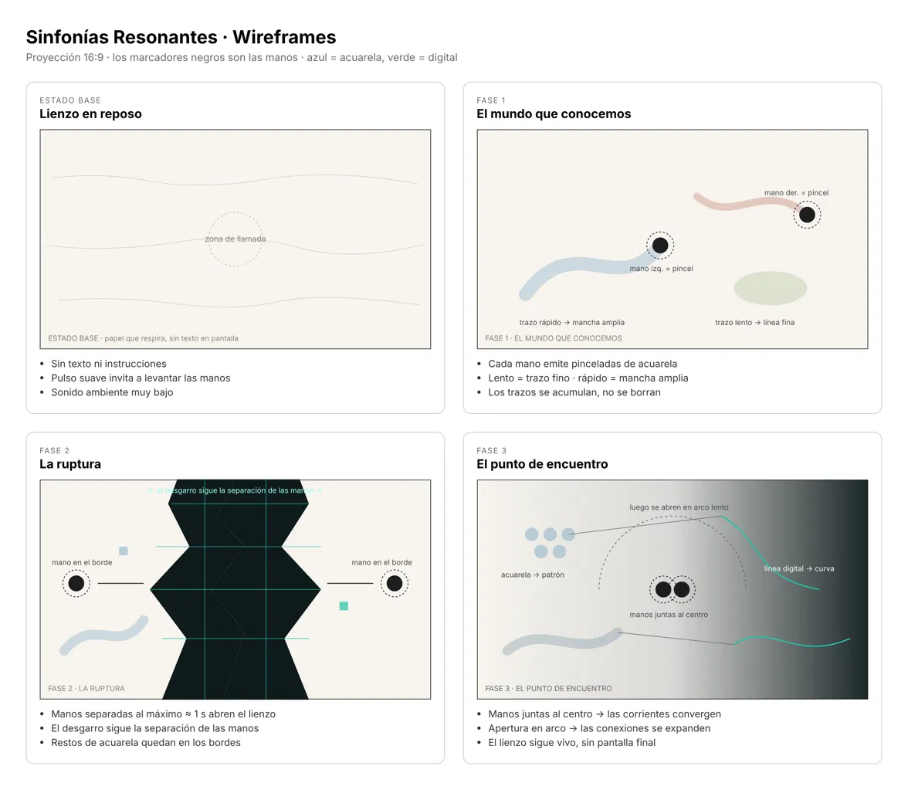

# Sinfonías Resonantes

### Bitácora de diseño: del lienzo tradicional a la creatividad expandida

## 1. Sobre el proyecto en general (mi visión)

Sinfonías Resonantes es una instalación audiovisual interactiva que busca transformar las manos del usuario en un pincel digital y en un instrumento gestual. La propuesta conecta los gestos de las manos con pinceladas que se comportan como acuarela, estructuras visuales generadas mediante algoritmos y un sistema de síntesis sonora en tiempo real, generando una composición audiovisual que se encuentra en constante cambio y evolución.

Mi objetivo es que el espectador no necesite mandos ni controles físicos para interactuar con la experiencia: basta con levantar las manos frente a una cámara. La posición, la velocidad y la forma de las manos (un dedo extendido, una pinza, un puño, la palma abierta) generan diferentes respuestas visuales y sonoras, haciendo que cada interacción produzca resultados distintos.

La experiencia está construida alrededor de un lienzo que cambia progresivamente de naturaleza. Inicialmente, este se comporta como una superficie tradicional, donde los movimientos de las manos generan pinceladas orgánicas que recuerdan al uso de pigmentos y acuarelas. Sin embargo, a medida que la persona interactúa con el sistema, el lienzo comienza a transformarse, revelando un lenguaje visual relacionado con los algoritmos, las estructuras digitales y los comportamientos generativos.

Me gustaría que esta transformación no representara simplemente un cambio estético, sino una reflexión sobre cómo las nuevas tecnologías pueden modificar nuestra manera de crear y la forma en la que entendemos aquello que ya conocemos.

La experiencia está dividida en tres etapas: el mundo que conocemos, la ruptura y el punto de encuentro. Estas representan una progresión desde una forma de creación que reconocemos, pasando por el conflicto que puede producir la aparición de nuevas herramientas, hasta llegar a una relación en la que lo tradicional y lo tecnológico pueden coexistir y generar nuevas posibilidades.

A partir de esto, Sinfonías Resonantes busca explorar cómo la tecnología puede convertirse en una extensión de nuestra creatividad, permitiéndonos no solamente materializar las ideas que tenemos en mente, sino también descubrir cosas que no habríamos imaginado por nuestra cuenta.

## 2. Mi pregunta y el fundamento conceptual

Inicialmente, no tenía una idea o un fundamento central sobre el porqué hacer esto, más allá de una reinvención de mi trabajo de mitad de semestre, el cual consistía en una experiencia de lienzo interactivo en la que el cuerpo funcionaba como un pincel digital.

Sin embargo, durante el proceso de diseño empecé a cuestionarme qué era lo que realmente quería comunicar con esta propuesta. Hasta ese momento, mi interés estaba más relacionado con la posibilidad de construir una experiencia visual y sonora que reaccionara al movimiento del usuario, pero sentía que todavía faltaba algo que justificara las decisiones que estaba tomando más allá de lo estético y lo técnico.

### 2.1. El cuestionamiento del *Why Bother?*

Hace poco, en una materia, empezamos a abordar un tema relacionado con la pregunta *Why Bother?*, y es que últimamente este ha sido un tema de discusión debido al desarrollo de la inteligencia artificial. A veces nace el dilema de si en verdad vale la pena seguir enseñando y aprendiendo cosas cuando una IA puede hacerlas sin necesidad de que nosotros conozcamos todos los detalles del proceso.

Esta pregunta me hizo pensar en cómo, en ocasiones, dejamos de intentar hacer algo porque creemos que alguien más ya lo hizo, porque conocemos un intento anterior que fracasó o porque pensamos que no tiene sentido dedicar tiempo a algo que otra persona o herramienta puede producir con mayor facilidad.

Siento que este tipo de pensamientos pueden convertirse en una limitación cuando empezamos a interpretar la existencia de otras posibilidades como una razón para dejar de explorar las nuestras. Que algo ya exista no significa que no podamos reinterpretarlo, y que una persona haya fracasado al intentarlo tampoco significa que no podamos aprender de ese proceso o encontrar una dirección diferente.

Sinceramente, creo que con la inteligencia artificial estamos viviendo una situación similar. Cada vez existen más herramientas capaces de producir imágenes, música, textos y otros resultados que antes requerían conocimientos y procesos específicos. Esto puede generar incertidumbre respecto al valor de lo que aprendemos y hacemos, pero también puede abrir nuevas posibilidades para explorar ideas que anteriormente parecían demasiado difíciles de materializar.

Personalmente, opto por la opinión de ver la tecnología como una extensión del ser humano y no necesariamente como algo que llega para reemplazarlo. Esto no significa que todas las tecnologías sean beneficiosas en cualquier situación, sino que me interesa explorar qué sucede cuando dejamos de verlas únicamente como una amenaza y empezamos a experimentar con las posibilidades que nos ofrecen.

Por más que una herramienta pueda realizar ciertas tareas de manera autónoma, sigue existiendo una relación entre los conocimientos que tenemos, las preguntas que formulamos, las decisiones que tomamos y las ideas que queremos explorar.

Es precisamente en esa relación donde quiero enfatizar, porque considero que una parte importante de crear no consiste únicamente en obtener un resultado, sino también en imaginar qué queremos hacer, experimentar con diferentes posibilidades y tomar decisiones a partir de lo que vamos descubriendo.

### 2.2. La relación entre el arte tradicional y las nuevas tecnologías

Durante el desarrollo de la propuesta empecé a pensar en cómo las distintas herramientas han transformado históricamente nuestras formas de crear. El dibujo manual, la pintura, la fotografía, el diseño digital y las herramientas generativas forman parte de diferentes maneras de producir y experimentar con imágenes.

La aparición de una nueva herramienta puede modificar los procesos que conocíamos, introducir nuevas posibilidades e incluso generar dudas respecto al valor de las técnicas anteriores. Sin embargo, no considero que cada nueva tecnología tenga que reemplazar completamente aquello que existía antes.

Me interesa pensar en cómo podemos utilizar el pasado como punto de partida para construir nuevas formas de expresión. Las técnicas tradicionales tienen características que no necesariamente desaparecen con la llegada de herramientas digitales, mientras que estas últimas permiten explorar comportamientos y posibilidades que pueden resultar difíciles de producir mediante otros procesos.

A partir de esto, me gustaría que Sinfonías Resonantes representara esa tensión mediante la transformación de un lienzo tradicional en una composición tecnológica. Inicialmente, el usuario interactúa con una superficie que responde a sus manos mediante pinceladas de acuarela. Posteriormente, un gesto específico provoca una ruptura que fractura el cuadro y revela un sistema visual diferente, como si la superficie estuviera mostrando otra manera de construir imágenes.

Esta transformación no busca demostrar que el arte digital es superior al arte tradicional, ni que lo nuevo necesariamente tiene que destruir lo anterior. Me interesa representar el conflicto que puede surgir cuando dos formas de crear parecen incompatibles, para después explorar cómo pueden relacionarse y producir algo diferente.

La tecnología no tiene que borrar nuestra historia para ampliar nuestras posibilidades. También puede reinterpretar lo que ya existe y permitirnos descubrir nuevas formas de utilizarlo.

### 2.3. La aparición de *Random Access Memories* durante el proceso de diseño

En medio de este proceso de reflexión, hubo un referente que cambió en gran medida la forma en la que me gustaría expresar la idea de la instalación: el álbum *Random Access Memories*, publicado por Daft Punk en 2013.

Hasta hace poco vine a caer en cuenta de que este álbum podía relacionarse con algunas de las preocupaciones que estaba intentando abordar en mi proyecto. A partir de su propuesta y de las interpretaciones que se hacen sobre su relación con la humanidad y la tecnología, empecé a pensar en cómo la tecnología puede llegar a generar una preocupación respecto a la pérdida de nuestra humanidad, nuestra creatividad y aquello que consideramos propio de nosotros.

Sin embargo, lo que más me interesa de este referente es la posibilidad de pensar en la tecnología no necesariamente como un reemplazo de lo humano, sino como una herramienta que puede formar parte de un proceso creativo en el que siguen siendo importantes las personas, sus decisiones, sus interpretaciones y su intención.

Esta reflexión cambió la manera en la que me gustaría abordar Sinfonías Resonantes. Inicialmente, estaba pensando en una experiencia que mostrara cierto rechazo hacia la inteligencia artificial para después llegar a una reconciliación con ella. Ahora me interesa más explorar la relación entre la creatividad humana y la tecnología, entendiendo que no necesariamente tienen que competir o convertirse en lo mismo para producir algo significativo.

Por eso, me gustaría que la obra no terminara con la desaparición de uno de los dos lenguajes visuales, sino con una composición en la que ambos puedan conservar sus características y, al mismo tiempo, transformarse a partir de su interacción.

### 2.4. Pregunta central

A partir de esta reflexión, la pregunta que orienta la propuesta es:

**¿Cómo puede la tecnología ampliar nuestra creatividad y permitirnos descubrir posibilidades que no habríamos imaginado por nuestra cuenta?**

La intención es explorar esta pregunta mediante una experiencia en la que el usuario pueda observar cómo sus gestos generan resultados, pero también cómo estos resultados pueden transformarse de maneras que no controla completamente.

La obra busca representar cómo podemos pasar de percibir la tecnología como una amenaza para aquello que conocemos a utilizarla como un medio para ampliar nuestras posibilidades creativas.

No se trata de afirmar que todo lo nuevo es mejor o que debemos abandonar las técnicas anteriores, sino de explorar qué puede surgir cuando dejamos de interpretar estas diferencias como una elección entre dos extremos.

De esta manera, la tecnología no se presenta como algo que simplemente obedece instrucciones, sino como parte de un sistema con el que podemos experimentar, tomar decisiones y descubrir nuevas posibilidades.

## 3. Sobre la experiencia y sus interacciones

La experiencia consiste en un lienzo audiovisual que utiliza las manos del usuario como fuente de movimiento y de interacción. A partir del seguimiento de 21 puntos por mano (hasta dos manos a la vez), el sistema reconoce la posición de las yemas y la forma de la mano, y la traduce en pinceladas que dejan rastros similares a la acuarela, mientras un conjunto de comportamientos generativos transforma progresivamente la apariencia y las dinámicas del lienzo.

La experiencia está dividida en tres fases: el mundo que conocemos, la ruptura y el punto de encuentro. No funcionan como niveles de un videojuego ni como pantallas que haya que superar: los cambios se producen mediante dos gestos con ambas manos que modifican las reglas del sistema, y las transiciones visuales y sonoras hacen perceptible la transformación.

Una decisión importante es que **los mismos gestos funcionan en las tres fases, pero cambian de lenguaje**. El usuario no tiene que aprender controles nuevos; lo que cambia es cómo responde el lienzo a lo que ya sabe hacer. Así, la transformación se percibe en el resultado y no en las instrucciones.

### 3.1. Estado base: un lienzo en movimiento

Antes de la interacción, el lienzo presenta una apariencia de papel con textura (encolado, relieve y fibras generadas de forma procedural). La experiencia comienza con un clic en la pantalla de inicio, que además activa el sonido (los navegadores exigen una interacción antes de reproducir audio).

Cuando la cámara detecta las manos, las yemas aparecen como puntos de luz y en una esquina se muestra una pequeña vista de la cámara para que el usuario entienda que está siendo leído. Cada mano tiene su propio pincel, así que se puede pintar con las dos a la vez. El ratón sigue funcionando como alternativa, lo que permite probar la obra sin cámara.

### 3.2. Fase 1: El mundo que conocemos

En esta primera fase quiero representar el valor de las formas tradicionales de crear y la relación entre el gesto y el resultado visual.

**Interacción visual:**

- **Índice extendido:** pincel. Lento produce trazos concentrados; rápido produce trazos anchos, aguados y con salpicaduras.
- **Pinza pulgar–índice:** trazo fino.
- **Abrir la palma de golpe (desde el puño):** una gota de tinte por cada yema.
- **Girar la muñeca:** remolino en el agua todavía húmeda.
- **Puño sostenido:** papel secante, que levanta el pigmento húmedo.
- Los giros bruscos del trazo dejan acumulaciones de pigmento, y el agua nueva sobre zonas húmedas produce floraciones.
- La pintura se acumula y se seca con bordes duros y granulación; no se borra.

**Interacción sonora:**

- Un colchón armónico de cuatro voces en La menor (Am9 – Fmaj7 – C – G6) que cambia de acorde cada ~8,5 s.
- Texturas de aire y agua.
- Los trazos tocan notas del acorde vigente, y cada gesto de mano tiene su propio sonido.

**La intención de esta fase** es que el usuario reconozca su capacidad para crear mediante sus manos y que perciba un lenguaje visual reconocible. La transformación posterior tendrá más significado si el usuario siente que algo que conocía está cambiando.

### 3.3. Fase 2: La ruptura

En esta fase quiero representar el momento en el que una nueva tecnología transforma las reglas que conocíamos.

**Gesto de activación:** separar mucho las dos manos y mantenerlas así durante ~1,5 s. Mientras se sostiene la pose aparece un anillo de progreso entre las manos, la cámara tiembla cada vez más, suena un latido con un tono ascendente y el fondo se enfría y se apaga a latidos. Si el usuario suelta antes, la señal se disipa y no ocurre nada.

**La ruptura como digitalización forzada (~7,5 s):**

1. El cuadro implosiona hacia el punto elegido (0–0,6 s).
2. Un impacto lo agrieta en fracturas de Voronoi que irradian desde ahí, con desgarros horizontales y temblor de cámara.
3. Los fragmentos se desplazan y caen mientras la pintura se cuantiza en bloques cada vez mayores y pierde el color (0,6–4 s).
4. Los fragmentos se apagan uno a uno hasta el negro y, solo entonces, de la oscuridad nace una red (desde 2,6 s).

**El lenguaje tecnológico:**

- **Physarum:** una red de 65 536 agentes simulados en GPU nace sobre las manchas, usa el pigmento como alimento y teje una red luminosa que conecta los trazos.
- **Reacción-difusión (Gray-Scott):** vetas tipo laberinto o huella dactilar crecen desde las manchas, llevan el tono del pigmento donde nacieron y envejecen y se retiran tras 40–60 s.
- **Noche y relieve:** el papel se apaga, el pigmento emite su propio tono y su densidad se eleva como una topografía con luz rasante.
- **Marmolado y pliegues:** un campo vectorial arrastra lentamente el pigmento seco y el lienzo se pliega siguiendo las manchas dominantes.

**Interacción en esta fase:** el gesto ya no pinta ni remueve el cuadro; solo engendra líneas nuevas de la red, que avanzan en la dirección de la mano y luego son absorbidas por el comportamiento colectivo. Los demás gestos también cambian: abrir la palma produce un estallido de líneas, la pinza crea un pozo de gravedad, el giro enrosca la red en espiral y el puño lanza una onda de choque.

**Interacción sonora:** un bloque tenso con segundas menores, un pulso grave, el crepitar de la red y un chasquido cada vez que el gesto engendra líneas. La ruptura tiene su propia secuencia: zumbido, grieta, golpe grave, tonos digitales que descienden, casi silencio y un retumbo del que surge la red.

**La intención de esta fase** es representar una tecnología con la que cuesta interactuar: el usuario siente que sus habilidades ya no funcionan como antes. Se relaciona directamente con el *Why Bother?*: el momento en que las reglas que conocíamos parecen dejar de ser suficientes. Aun así, no es una destrucción definitiva: la red se alimenta del pigmento y crece desde lo que el usuario pintó.

### 3.4. Fase 3: El punto de encuentro

**Gesto de activación:** juntar las dos manos y mantenerlas así durante ~1,5 s. Igual que antes, aparece el anillo de progreso, pero esta vez el fondo anticipa una luz cálida. En zonas muy densas del lienzo la carga es más lenta, y durante la apertura mover las manos despacio orienta la expansión.

**Qué ocurre:** un frente de integración se expande desde el punto elegido. Dentro de él:

- el papel recupera la luz y la red de physarum se convierte en tinta que rellena los huecos entre manchas;
- el trazo siembra vetas de reacción-difusión de su color y atrae agentes de la red;
- cada trazo recibe una respuesta en *canon*: un eco espejado 1,3 s después, en un color armónico;
- el campo guía la difusión del pigmento y el pigmento curva el campo (un bucle de retroalimentación entre ambos lenguajes);
- cuando el lienzo supera ~42 % de cobertura, un frente sale del último gesto y traslada toda la obra a la siguiente paleta (papel → terracota → nocturno → tinta → brasas), aclarando lo anterior para abrir espacio.

**Interacción sonora:** la armonía se resuelve en Re mayor (Dmaj9 – Bm11 – Gmaj7 – A6sus), las notas se cuantizan al pulso como campanas FM y el volumen general baja ~45 %.

**La intención de esta fase** es que el usuario experimente cómo la tecnología puede ampliar su creatividad sin reemplazar lo que ya conoce. El eco en canon es la metáfora más directa: el sistema responde a la persona con algo que ella no habría dibujado, pero que nace de su gesto. Las huellas de la acuarela y de la ruptura permanecen en la composición, y el lienzo sigue evolucionando aunque el usuario deje de moverse: el agua se seca y la red y las vetas crecen y se renuevan.

## 4. Gestos, sonido y reacciones visuales

### 4.1. Entradas

- **Posición de las yemas y de la palma:** dónde se emiten las pinceladas y en qué región actúa el usuario.
- **Velocidad de la mano:** energía, ancho, agua y salpicaduras del trazo, e intensidad del sonido.
- **Forma de la mano:** índice extendido, pinza, puño, palma abierta y giro de la muñeca.
- **Distancia entre las dos manos:** pose *separadas* (ruptura) o *juntas* (encuentro).
- **Duración de la pose:** si la condición se mantiene lo suficiente para activar una transición.
- **Estado de la experiencia y densidad del lienzo:** qué reglas están activas y cuánto tarda en cargarse el encuentro.

Estas variables no funcionan como controles independientes para cada efecto: modifican las condiciones de un mismo sistema, de manera que los cambios visuales y sonoros sean el resultado de las mismas relaciones.

### 4.2. Tabla de gestos por fase

| Gesto | Fase I · acuarela | Fase II · tecnología | Fase III · encuentro |
|---|---|---|---|
| Índice extendido | Pincel | Engendra líneas de la red | Pincel híbrido + red + eco |
| Abrir la palma de golpe | Una gota de tinte por yema | Estallido de líneas por yema | Vetas + tinte armónico por yema |
| Pinza pulgar–índice | Trazo fino | Pozo de gravedad para la red | Trazo fino híbrido |
| Girar la muñeca | Remolino en el agua húmeda | La red se enrosca en espiral | Remolino que mezcla con lo digital |
| Puño sostenido | Papel secante | Onda de choque que dispersa la red | Condensa color y siembra vetas |
| **Separar mucho las manos ~1,5 s** | → **Ruptura** | — | — |
| **Juntar las manos ~1,5 s** | — | → **Encuentro** | — |

### 4.3. Umbrales gestuales

Para evitar cambios por movimientos accidentales, trabajo con umbrales calculados a partir de los puntos de la mano, en lugar de entrenar un clasificador de poses:

- los dedos se miden en 3D y en proporción al tamaño de la propia mano, así que girar o inclinar la palma no cambia el gesto detectado;
- cada gesto tiene histéresis (un umbral para activarse y otro distinto para soltarse);
- abrir la palma solo cuenta si ocurre hasta 0,8 s después de cerrar el puño, y el giro exige una rotación acumulada real;
- las poses de transición requieren ~1,5 s sostenidos, con retroalimentación progresiva (anillo, temblor, latido) para comunicar que algo está pasando sin instrucciones escritas.

Estos valores están calibrados a las proporciones reales de la mano y deben ajustarse en la sala de exhibición.

### 4.4. Reglas de comportamiento

1. Las manos deben ser siempre visibles en pantalla (puntos de luz en las yemas).
2. Las pinceladas deben mantener una relación perceptible con los movimientos de las manos.
3. La transformación del lienzo debe producirse progresivamente y responder a los gestos definidos.
4. Las huellas de las etapas anteriores deben permanecer parcialmente visibles en las etapas posteriores.
5. La estética digital no debe reemplazar por completo la estética tradicional.
6. La fase final debe producir nuevas relaciones entre ambos lenguajes, sin limitarse a superponerlos.
7. El sonido debe responder tanto a los gestos como a las transformaciones generales del sistema.
8. El lienzo debe continuar evolucionando incluso cuando el usuario permanece quieto.
9. Las transiciones deben evitar cambios accidentales causados por fluctuaciones del seguimiento.
10. La experiencia debe permitir seguir explorando después de alcanzar la tercera fase.

Estas reglas buscan un equilibrio entre la intención humana y el comportamiento autónomo del sistema. Si el usuario controla absolutamente todo, el entorno pierde su capacidad de sorprenderlo; si el sistema actúa sin responder a sus gestos, la participación deja de importar.

## 5. Referentes visuales, conceptuales y técnicos

### 5.1. Zach Lieberman — [*100 Sunsets*](https://www.instagram.com/p/DclvUDmObne/), [*Watercolor*](https://www.instagram.com/p/DZY2UvzM11w/), [*Animation for NYT*](https://www.instagram.com/p/DWmGtq-ER0y/?img_index=2)

<video controls src="videosReadMe/AnimationForNYT.mp4" title="Title"></video>

**Qué tomo:** la idea de que un sistema generativo puede producir trazos que se sienten más cercanos a una pincelada que a una animación geométrica, y cómo la acumulación de rastros construye la composición.

**En qué me distancio:** en buena parte del trabajo de Lieberman la acuarela es una *apariencia* (formas con transparencia y color). En Sinfonías Resonantes intenté que fuera un *comportamiento*: el pigmento se guarda como absorbancia y se mezcla de forma sustractiva (ley de Beer–Lambert), el agua fluye según la permeabilidad del papel y los bordes se forman al secarse. Además, en mi obra la acuarela no es el fin, sino el punto de partida de una transformación.

### 5.2. Memo Akten — [*Equilibrium*](https://memo.tv/projects/2014/equilibrium/), [*Reincarnation*](https://memo.tv/projects/2009/reincarnation/)

**Qué tomo:** la relación entre el cuerpo y un sistema audiovisual generativo en la que el movimiento forma parte de un comportamiento más amplio, en vez de producir una respuesta inmediata y uno a uno.

**En qué me distancio:** las obras de Akten suelen sostener un mismo sistema durante toda la experiencia. La mía cambia deliberadamente sus reglas a mitad del recorrido, y esa ruptura es el centro del significado. Eso implica un riesgo que él no tiene: el usuario puede sentir que el sistema "dejó de funcionar". Por eso añadí retroalimentación clara (las líneas de la red siguen la dirección de la mano) para que la frustración de la fase II sea intencional y no confusa.

### 5.3. Golan Levin y Zach Lieberman — *Messa di Voce* (2003)

**Qué tomo:** una instalación en la que la voz y el cuerpo generan visuales y sonido a la vez, y en la que el sistema "responde" con comportamientos propios. Es un precedente directo de mi idea de que la imagen y el sonido salgan de las mismas relaciones.

**En qué me distancio:** *Messa di Voce* traduce la voz en formas de forma bastante directa. En mi obra el eco en canon de la fase III no copia el gesto: lo espeja, lo retrasa y lo cambia de color, para que el usuario reciba algo que no dibujó.

### 5.4. Camille Utterback y Romy Achituv — *Text Rain* (1999)

**Qué tomo:** la interacción sin instrucciones: el público entiende en segundos que su silueta afecta lo que cae. Es mi referencia para que la experiencia se entienda sin texto en pantalla.

**Limitación que identifico:** *Text Rain* tiene una sola regla durante toda la obra. Al tener tres fases con reglas distintas, yo necesito comunicar los cambios de regla, y por eso las transiciones tienen anillo de progreso, temblor, latido y cambio de luz.

### 5.5. Referentes técnicos: physarum y reacción-difusión

- **Physarum (Jeff Jones, 2010; trabajos de Sage Jenson):** modelo de agentes que imitan al moho mucilaginoso. Me interesa porque es un sistema autónomo que "se alimenta" de lo que existe: en mi obra los agentes usan el pigmento como alimento, lo que traduce la idea de que la tecnología crece desde lo humano.
- **Reacción-difusión Gray-Scott (difundida por Karl Sims):** genera patrones orgánicos (laberintos, huellas dactilares) a partir de reglas matemáticas simples. Es un puente natural entre lo orgánico y lo algorítmico, por eso aparece en la ruptura y se vuelve protagonista en el encuentro.

### 5.6. Daft Punk — *Random Access Memories* (2013)

Este álbum apareció durante el proceso de diseño y cambió la forma de expresar la idea de la instalación. Su relación conceptual con la humanidad, la tecnología y la producción musical me llevó a pasar de una experiencia centrada en el rechazo y la posterior aceptación de la tecnología a una exploración de lo que surge de su relación con la creatividad humana. No traslado su estética al lienzo: lo uso como referente conceptual. Donde sí se nota es en el sonido: la obra pasa de una armonía tensa a una resolución, y la tecnología termina "tocando" junto a la persona (el canon) en lugar de reemplazarla.

### 5.7. La transformación del arte tradicional al digital

Las técnicas tradicionales y las tecnologías digitales pueden entenderse como formas distintas de crear, cada una con sus posibilidades. Esta idea se refleja en las tres etapas del lienzo: la primera presenta un lenguaje orgánico y reconocible; la segunda introduce una ruptura que modifica sus reglas; y la tercera explora cómo ambos lenguajes se relacionan sin que uno tenga que desaparecer.

## 6. Concreción mediante las ocho operaciones de mentalidad generativa

### 6.1. Intención

Explorar cómo la tecnología puede ampliar nuestra creatividad y permitirnos descubrir posibilidades que no habríamos imaginado por nuestra cuenta, mostrando que la aparición de nuevas herramientas no tiene que invalidar aquello que ya conocemos.

### 6.2. Entidades

- Manos del usuario (hasta dos) y sus 21 puntos detectados.
- Puntos de luz que representan las yemas.
- Pinceladas, agua y pigmento.
- Papel del lienzo.
- Fragmentos de la ruptura.
- Red de physarum y vetas de reacción-difusión.
- Campo vectorial compartido.
- Sistema de síntesis sonora.
- Estados de la experiencia (fases y transiciones).
- Composición audiovisual final y sus paletas.

### 6.3. Relaciones

- Las manos generan pinceladas a partir de su posición, velocidad y forma.
- El pigmento se acumula, se difunde con el agua y se seca sobre el papel.
- Separar las manos activa la ruptura; juntarlas activa el encuentro.
- La red de physarum se alimenta del pigmento; las vetas crecen desde las manchas.
- En la fase III el campo guía al pigmento y el pigmento curva el campo.
- Cada trazo recibe un eco en canon del sistema.
- Los cambios visuales modifican la composición sonora.

### 6.4. Entradas

- Posición de yemas y palma.
- Velocidad de las manos.
- Forma de la mano (índice, pinza, puño, palma abierta, giro).
- Distancia entre las dos manos.
- Duración de las poses.
- Estado de la experiencia y densidad del lienzo.
- Tiempo transcurrido desde cada transición.

### 6.5. Reglas

Las entradas modifican la emisión de pigmento, la transformación del lienzo, las fuerzas entre los elementos visuales y los parámetros sonoros. Los umbrales gestuales activan las transiciones entre fases. La fase I usa comportamientos orgánicos de acuarela; la II introduce estructuras digitales que se alimentan de lo pintado; la III crea una retroalimentación entre ambos sistemas.

### 6.6. Invariantes

- Las manos siempre son visibles en pantalla.
- Las acciones del usuario mantienen una relación reconocible con las respuestas del sistema.
- Las huellas de las etapas anteriores permanecen parcialmente visibles.
- La tecnología no elimina completamente las características del lenguaje tradicional.
- El sistema sigue evolucionando sin interacción.
- El sonido sigue relacionado con los gestos y las dinámicas del entorno.
- Las transiciones son progresivas y responden a gestos definidos.

### 6.7. Variabilidad

La experiencia produce composiciones distintas según las trayectorias, la densidad de las pinceladas, las mezclas cromáticas, la velocidad, el crecimiento de la red y de las vetas, y la paleta en la que se encuentre. Aunque dos usuarios recorran las mismas fases, sus resultados serán diferentes. La tercera fase no tiene una composición final predeterminada: los cambios de paleta y la renovación de las vetas mantienen la obra abierta.

### 6.8. Curaduría y reflexión

No toda variación aleatoria comunica la idea del proyecto. Por eso será necesario probar las reglas de interacción con usuarios y observar si reconocen la relación entre sus gestos y el lienzo, si entienden la ruptura como un cambio de reglas y si perciben la coexistencia en la fase final.

## 7. Herramientas, planificación técnica y desafíos

### 7.1. Herramientas

| Herramienta | Uso en el proyecto |
|---|---|
| **MediaPipe Tasks Vision 0.10.14 — Hand Landmarker** | Visión artificial: detección de hasta dos manos con 21 puntos cada una (2D y 3D), en el propio equipo y con aceleración por GPU (si falla, CPU). |
| **Three.js 0.169** | Render en WebGL2: texturas de simulación, *shaders* personalizados, cámara y superficie del lienzo. |
| **GLSL (shaders propios)** | Simulación de pigmento y agua, physarum, reacción-difusión, fracturas de la ruptura y composición final. |
| **Web Audio API** | Síntesis sonora procedural (acordes, ruido filtrado, campanas FM, latidos), sin librerías externas. |
| **Vite 5.4** | Servidor de desarrollo y compilación para producción. |
| **GitHub Pages + GitHub Actions** | Publicación por HTTPS, requisito del navegador para usar la cámara. |

**Sobre ML5.js y Teachable Machine:** decidí trabajar directamente con MediaPipe Hand Landmarker, que es el mismo modelo que usa `ml5.handPose`. Usarlo sin la capa de ml5 me permite acceder a los puntos 3D (`worldLandmarks`), elegir la delegación GPU/CPU y controlar la frecuencia de detección para no competir con la simulación gráfica. No usé Teachable Machine porque los gestos se reconocen con reglas geométricas sobre los puntos de la mano (distancias normalizadas, histéresis, ventanas de tiempo) en lugar de un clasificador entrenado: esto evita depender de un conjunto de datos propio y hace que los gestos funcionen igual con manos de distintos tamaños.

### 7.2. Arquitectura

- `InputController` expone un vocabulario de intenciones (cursor, umbral, toque, gesto, pose). El ratón y las manos son dos fuentes del mismo vocabulario, así que el resto del sistema no sabe de dónde viene la entrada.
- `ExperienceController` coordina cada cuadro: entrada → narrativa → sistemas → render.
- `TransitionController` maneja las fases y la carga de los umbrales.
- Sistemas independientes: acuarela, pincel, campo, physarum, reacción-difusión, estructuras, paletas e híbrido.
- `PerformanceMonitor` degrada la calidad de forma progresiva.

### 7.3. Etapas de desarrollo

1. **Seguimiento de manos y pincel:** detección con MediaPipe, puntos de luz en las yemas, pincel por mano y alternativa con ratón.
2. **Lienzo tradicional:** simulación de agua y pigmento en GPU, bordes de marea, granulación, floraciones y gestos de la fase I.
3. **Ruptura:** detección de la pose de manos separadas, secuencia de fractura y nacimiento de la red de physarum.
4. **Lenguaje tecnológico:** reacción-difusión, relieve, marmolado y gestos de la fase II.
5. **Encuentro:** pose de manos juntas, frente de integración, retroalimentación campo–pigmento, eco en canon y cambio de paletas.
6. **Sonido:** progresiones por fase, sonidos de gestos y secuencia de la ruptura.
7. **Refinamiento y pruebas:** rendimiento, calibración de umbrales en sala y pruebas con participantes.

### 7.4. Meta de rendimiento

- **Objetivo: 60 FPS; mínimo aceptable: >30 FPS.**
- La cámara se captura a 640×480 y la detección corre como máximo 25 veces por segundo, separada del render, porque comparte GPU con la obra.
- La simulación corre a ≤1100 px, el campo vectorial a 192 px y el análisis del lienzo a 144 px solo cuando hay eventos.
- Si los cuadros superan ~21 ms (≈48 FPS) durante 1,5 s, el sistema baja un nivel de calidad (resolución de render y de simulación, subpasos e iteraciones), conservando la pintura. Hay cuatro niveles.
- No se crean objetos nuevos por cuadro en el bucle de render, y al reiniciar se liberan geometrías y materiales.

### 7.5. Desafíos técnicos y soluciones

| Desafío | Solución |
|---|---|
| Temblor del seguimiento (*jitter*) | Filtro One Euro sobre el punto de pintura: suaviza en reposo sin añadir retraso en movimientos rápidos. |
| Pérdidas breves de la mano | Una mano puede desaparecer ~0,3 s sin cortar su trazo ni su pose. |
| MediaPipe intercambia las etiquetas izquierda/derecha | Cada mano se identifica por seguimiento de posición, no por la etiqueta. |
| Gestos que cambian al girar o inclinar la mano | Medidas en 3D y proporcionales al tamaño de la palma. |
| Transiciones accidentales | Poses sostenidas ~1,5 s, histéresis y retroalimentación progresiva; si se suelta antes, se disipa. |
| La detección y la simulación compiten por la GPU | Detección limitada a 25 Hz y a 640×480; respaldo en CPU si la GPU falla. |
| Equipos menos potentes | Degradación automática en cuatro niveles. |
| Una simulación física completa (Navier–Stokes) sería demasiado costosa | Aproximación por flujos entre vecinos con permeabilidad y umbrales de frente, que reproduce los fenómenos visibles a 60 FPS. |
| Saturación del lienzo en la fase III | Cambio de paleta al superar ~42 % de cobertura y envejecimiento de las vetas tras 40–60 s. |
| Políticas del navegador | El audio arranca tras el clic inicial; la cámara requiere HTTPS (GitHub Pages). |
| Privacidad | Todo el procesamiento de la cámara ocurre en el equipo; no se envía ninguna imagen. |
| Dependencia de internet en el primer uso | El modelo y el motor WASM se descargan la primera vez; en la exhibición conviene cargar la obra antes de abrirla al público. |
| Iluminación variable de la sala | Calibrar en sala con luz frontal estable y fondo poco cargado detrás del usuario. |

## 8. Diagramas

**Diagrama de flujo de la interacción.** Muestra cómo el sistema pasa de una fase a otra según los umbrales de las manos y qué ocurre si el gesto se suelta antes de tiempo.

**Wireframes de la composición visual.** Composición de cada fase en proyección 16:9, con los marcadores de las manos y las capas principales.

## 9. Evaluación de la experiencia

Para evaluar la propuesta, no quiero limitarme a comprobar si la simulación funciona o si el resultado es atractivo. También considero importante observar si la interacción permite explorar la intención conceptual del proyecto.

**Criterios:**

- **Correspondencia:** si el usuario reconoce que sus manos producen cambios en el lienzo.
- **Transformación:** si identifica la ruptura como un cambio importante en las reglas del sistema.
- **Coexistencia:** si percibe que lo tradicional y lo digital permanecen en la composición final.
- **Descubrimiento:** si encuentra resultados inesperados (el eco, los cambios de paleta) que lo llevan a probar nuevos gestos.
- **Creatividad expandida:** si siente que produjo algo que no habría imaginado inicialmente.

**Métricas técnicas:** FPS promedio y mínimo durante cada fase, nivel de calidad alcanzado, número de transiciones accidentales y tiempo que tarda cada usuario en descubrir los dos gestos de transición sin ayuda.

**Preguntas después de las pruebas:**

- ¿Qué crees que representaba el lienzo al comienzo?
- ¿Qué interpretaste cuando el cuadro se fracturó?
- ¿Sentiste que la transformación destruía lo que habías creado o que lo convertía en algo diferente?
- ¿Qué diferencias encontraste entre las primeras pinceladas y la composición final?
- ¿Sentiste que era necesario escoger entre los dos lenguajes visuales o que podían coexistir?
- ¿Hubo algún resultado visual o sonoro que no esperabas? ¿Qué hiciste después?
- ¿Sentiste que controlabas todo lo que ocurría o que explorabas junto con el sistema?

## 10. Síntesis de la propuesta

Sinfonías Resonantes es una instalación audiovisual interactiva que transforma las manos en un pincel digital y un instrumento sonoro. Mediante sus gestos, el usuario genera pinceladas que se comportan como pigmento en el agua, mientras un sistema generativo transforma progresivamente el lienzo y sus reglas.

La experiencia explora la relación entre creatividad humana y tecnología mediante tres fases: el mundo que conocemos, la ruptura y el punto de encuentro. El usuario pasa de crear sobre una superficie tradicional a provocar una fractura que revela un lenguaje digital, para finalmente descubrir una composición en la que ambos lenguajes coexisten y se transforman mutuamente.

La propuesta surge de una reflexión sobre el valor de la creatividad humana en un contexto en el que las tecnologías generativas producen resultados cada vez más complejos. A partir de esta inquietud y de *Random Access Memories*, el proyecto explora la tecnología no solo como una herramienta para materializar ideas, sino como un medio que puede transformar nuestras formas de crear y permitirnos descubrir resultados que no habríamos imaginado por nuestra cuenta.

**Pregunta central:** ¿Cómo puede la tecnología ampliar nuestra creatividad y permitirnos descubrir posibilidades que no habríamos imaginado por nuestra cuenta?

**Intención:** Explorar cómo la interacción entre la intención humana y un sistema tecnológico autónomo puede ampliar las posibilidades de creación, permitiendo que el proceso creativo produzca descubrimientos inesperados.

**Principio de interacción:** Las manos introducen intención en un lienzo que responde a sus gestos. Esos gestos transforman progresivamente las reglas del sistema, pero no determinan por completo sus resultados. La composición surge de la relación entre las acciones del usuario y las dinámicas autónomas del lienzo.

**Frase que resume la propuesta:**

*No tenemos que destruir lo que fuimos para descubrir lo que podemos llegar a ser.*